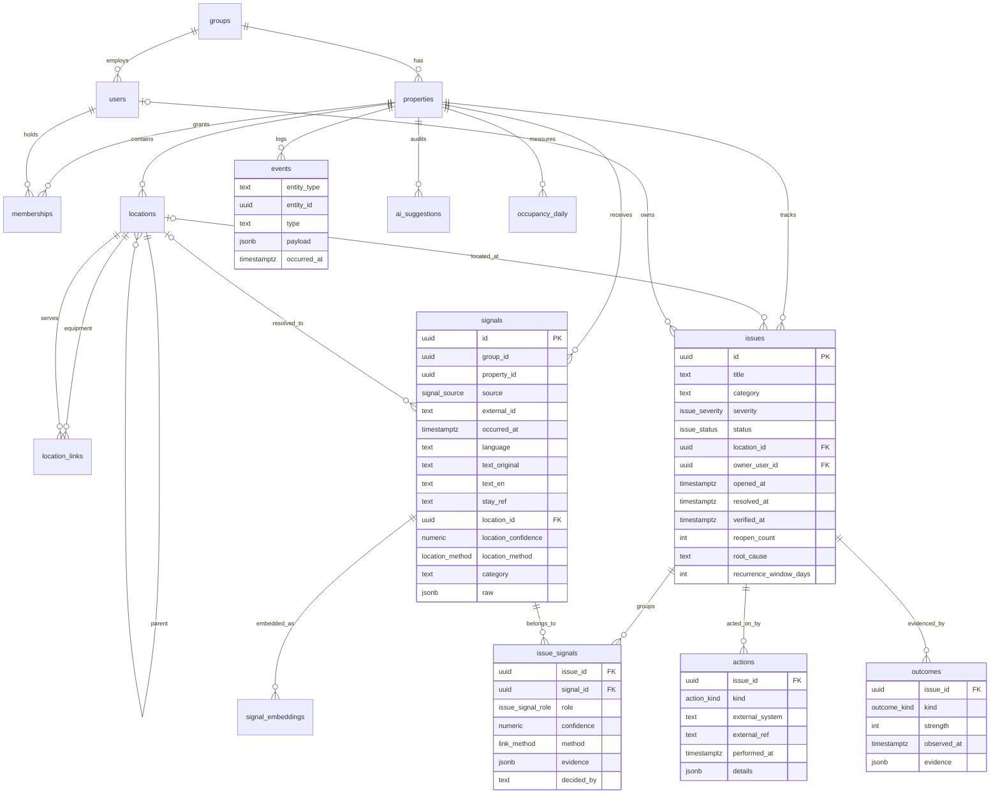

# Data model

The operational memory of the product: what was observed, what problem it
belongs to, what was done, and whether the fix held. Postgres 16 with pgvector,
Drizzle ORM, row-level security per property, personal data in a separate schema.

## Running it locally

```bash
cp .env.example .env            # defaults match docker-compose.yml
pnpm db:up                      # pgvector/pgvector:pg16 on localhost:5432
pnpm db:migrate                 # applies app/drizzle/* in order
pnpm db:seed                    # demo group + property + location hierarchy from ../data
pnpm db:load-synthetic          # raw exports from ../data/out into signals
pnpm db:test                    # drops/recreates hotel_ops_test, migrates, seeds, loads, tests
```

The synthetic exports come from `../data` (`cd ../data && uv sync && uv run
python -m generator --seed 42 --out out/`). `DATA_DIR` in `.env` points the
seed and loader elsewhere.

After a schema change: edit `src/db/schema/*.ts`, run `pnpm db:generate`, review
the SQL it wrote under `drizzle/`, then `pnpm db:migrate`. Policies, roles and
triggers are not expressed in the Drizzle schema; they live in
`drizzle/0002_rls_roles_triggers.sql` and any later hand-written migration
(`pnpm exec drizzle-kit generate --custom --name=...`).

## The four records



**Signal**: one raw observation, from any channel. The observation itself
(`source`, `external_id`, `occurred_at`, `text_original`, `raw`, `stay_ref`) is
immutable: a trigger rejects changes. The derived columns (`language`,
`text_en`, `location_*`, `category`) are filled in by normalisation and may be
corrected later. Uniqueness is `(property_id, source, external_id)`, so a
re-import of the same export is a no-op.

**Issue**: the underlying problem. Carries the lifecycle, the owner, the
location at the level the evidence supports (a room, a floor, a boiler), and
`root_cause` once it is known.

**Issue–Signal link**: which signals make up an issue, with `role`
(`primary` is the signal that opened it, `supporting` adds evidence,
`duplicate` is the same report logged twice), `confidence`, `method` (who
decided: a rule, an embedding match, a model, a person) and `evidence` (what
they saw). Every link is attributable.

**Action**: what was done, by reference. A ticket in hotelkit or Flexkeeping is
stored as `external_system` + `external_ref`; we never own tickets.

**Outcome**: evidence about whether the fix held, with a strength ladder:

| kind | strength | meaning |
|---|---|---|
| `guest_confirmed` | 3 | the guest said it works (room QR, follow-up message) |
| `staff_evidence` | 2 | a photo or dated note from the person who checked |
| `no_recurrence` | 1 | nothing new within the recurrence window (silence) |
| `recurred` | 0 | the problem came back; this reopens the issue |

Around them: **locations** (the hierarchy plus `aliases`, the spellings staff
actually type), **location_links** (what a boiler or chiller serves),
**events** (append-only log; a trigger rejects update and delete),
**ai_suggestions** (every model output with model, prompt version, input
references and the human decision), **signal_embeddings** (pgvector, HNSW,
cosine), **occupancy_daily** (the denominator for per-1,000-room-nights
metrics) and **pii.stay_keys** (see below).

## Issue lifecycle

```
detected ──assign──▶ assigned ──resolve──▶ resolved ──verify──▶ verified
    │                   │                     │                     │
    │                   │                     └──recurrence──▶ reopened ──assign──▶ assigned
    │                   │                                          ▲
    └───────────────────┴──── window elapses with no evidence ──▶ closed_unverified
```

- `detected`: created by a rule or the linking engine from one or more signals.
- `assigned`: an owner (user) and department are set; an `action` of kind
  `ticket_created` or `escalated` usually accompanies it.
- `resolved`: the responsible team says it is fixed (`resolved_at` set). The
  verification clock starts: `recurrence_window_days` (default 30; per
  category in practice, e.g. 7 for housekeeping misses, 90 for plumbing).
- `verified`: an `outcome` of strength ≥ 2 (`guest_confirmed` or
  `staff_evidence`) exists after `resolved_at`.
- `reopened`: any of
  - a new signal is linked whose `occurred_at` is after `resolved_at`, at the
    same location (or a child of it) and in the same category, within
    `recurrence_window_days`;
  - an `outcome` of kind `recurred` is recorded.
  `reopen_count` increments; the issue goes back to `assigned` when someone
  takes it.
- `closed_unverified`: the window elapsed after `resolved_at` with no evidence
  either way. An `outcome` of kind `no_recurrence` (strength 1) is recorded.
  This is the weakest end state and is reported separately from `verified`.

Every transition writes an `events` row (`issue.assigned`, `issue.resolved`,
`issue.verified`, `issue.reopened`, `verification.due`, ...). Digests, timers
and escalation rules consume the event log, never the issue table directly.

## Tenant context (row-level security)

Every tenant table carries `group_id` and `property_id`, and every one of them
has RLS enabled **and forced**. The policy on property-scoped tables is:

```sql
group_id = app_group_id() AND property_id = ANY (app_property_ids())
```

for both reads (`USING`) and writes (`WITH CHECK`). `groups` and `users` are
group-scoped; `properties` is visible when its group matches and it is named.
The helpers read two transaction-local settings:

```ts
await withTenant(db, { groupId, propertyIds: [propertyId] }, async (tx) => {
  // every query here sees only that property's rows
});
```

`withTenant` opens a transaction, runs `set_config('app.group_id', ..., true)`
and `set_config('app.property_ids', ..., true)` (the `true` makes them
transaction-local), then runs your function. Outside the transaction the
settings are gone and the app role sees nothing.

Roles:

| role | RLS | use |
|---|---|---|
| `app_user` (`DATABASE_URL_APP`) | applies | the web app; all user-facing queries |
| `app_migrator` / the compose superuser (`DATABASE_URL`) | bypassed | migrations, seeds, loaders, batch jobs |
| `pii_admin` | n/a | the only role with privileges on the `pii` schema |

The dev passwords are set in migration 0002; rotate them with `ALTER ROLE` in
any shared environment.

## Personal data

Operational tables never carry a guest. Stays are referenced by `stay_ref`, an
HMAC of the PMS reservation number under `STAY_REF_SECRET`. The mapping back
lives in `pii.stay_keys`, in its own schema, with no foreign key from `public`,
no privileges for `app_user`, and a test that proves the app role cannot
select from it. Nothing else is stored about guests: no names, contacts,
documents or payment data. Employee performance is not modelled anywhere.

## What the synthetic loader does (and does not)

`pnpm db:load-synthetic` reads `../data/out` and inserts one signal per record
with the original row kept in `raw`:

| export | source | location resolution | stay_ref |
|---|---|---|---|
| `work_orders.csv` | `work_order` | typed text matched against codes and aliases (exact/alias only) | — |
| `front_desk_log.xlsx` | `front_desk` | room cell matched the same way | — |
| `stays.csv` | `pms` | room code, always exact | yes |
| `surveys.csv` | `survey` | none (reaches the room through `stay_ref` later) | yes |
| `reviews.json` | `review` | none | — |
| `occupancy_daily.csv` | `occupancy_daily` table, per building | | |

For seed 42 the exact/alias pass locates about 72 % of work orders and 99 % of
front-desk rows. Everything else (language detection, translation, category
normalisation, the remaining locations, and all linking) is the job of the
normalisation and linking steps, which read `signals` and write only the
derived columns, `issue_signals` and `ai_suggestions`.
